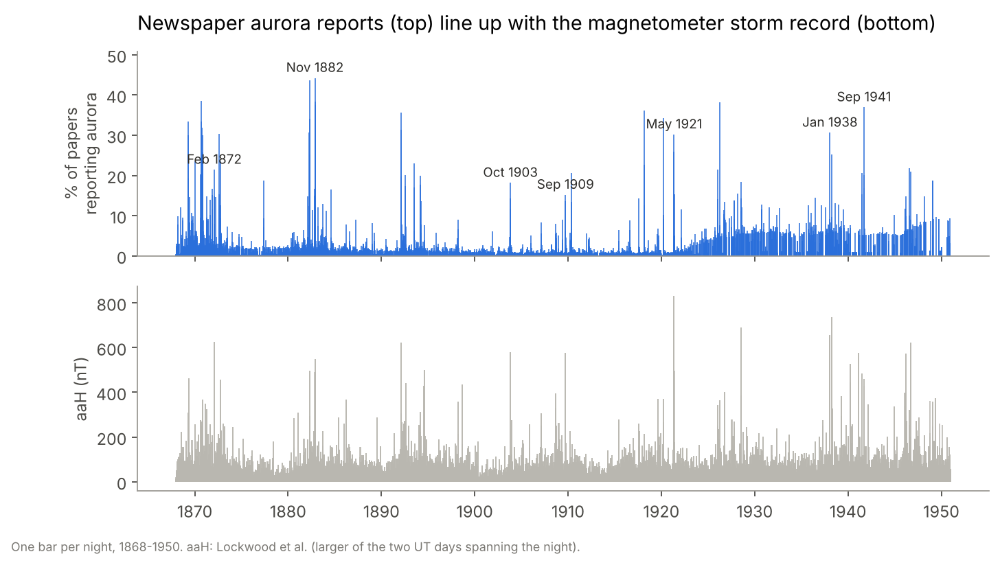
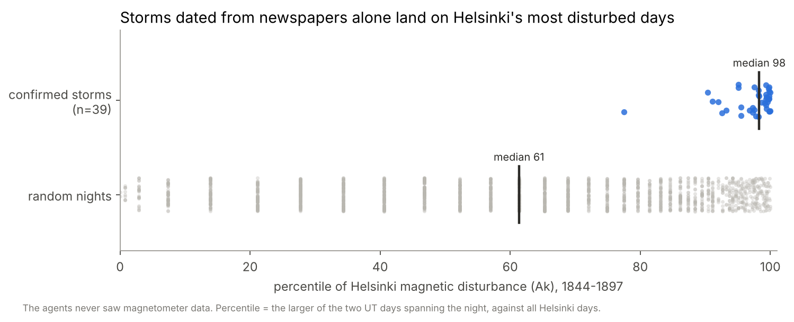
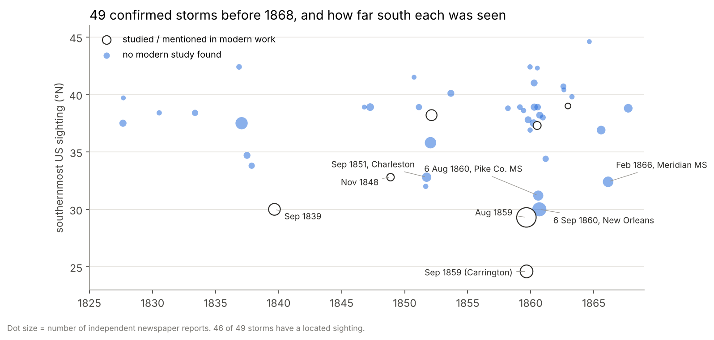

# Aurora Archives

A nightly index of low-latitude aurora sightings in US newspapers (1800–1963), and a catalogue of geomagnetic storms before 1868 built from it.

## Overview

Strong geomagnetic storms push the aurora toward the equator, and for most of the 19th century newspapers were where these sightings got recorded. This repository uses the digitised US newspaper archive to reconstruct when, and how far south, the aurora was seen on each night between 1800 and 1963.

The main outputs are:

- **A nightly aurora index (1800–1963):** the share of active US newspapers reporting an aurora sighting on each night, based on 326,123 candidate articles.
- **A catalogue of 49 confirmed storms from 1827 to 1867,** the period before continuous magnetic indices. Each storm comes with its dated sightings, the southernmost US location and the source articles.
- **A list of 41 storms with no modern study found,** including 6–7 September 1860, when the aurora was seen at New Orleans (30°N).

The motivation is space-weather risk. Estimates of how often extreme storms occur depend on a long record of past events, and the global magnetic indices only begin in 1868. Historical aurora sightings are one of the few ways to extend that record further back.

## Validation

**1868–1950.** Peaks in the newspaper index line up with storms in the aaH magnetic index (Lockwood et al.).



**1844–1867.** No global index exists for this period, so the catalogue is compared with the Helsinki magnetometer record. The storm dates were assigned from the newspaper text only, without access to any magnetic data.



| Metric | Value |
| --- | --- |
| Candidate articles (1800–1963) | 326,123 |
| Labelled training articles | 3,091 |
| Classifier, cross-validated on 5-year blocks | AUC 0.976; precision 0.77, recall 0.80 at threshold 0.3 |
| Agreement with an independent blind re-labelling (n = 300) | 99.3%, Cohen's κ = 0.97 |
| Top-10 index peaks, 1868–1950 | median aaH 368 nT (31 nT for all nights) |
| Major storms (aaH ≥ 400 nT) among the top-200 index peaks | 20 of 23 |
| Candidate nights reviewed, 1827–1867 | 152, giving 49 confirmed storms |
| Confirmed storms in Helsinki's top 5% of days | 33 of 39 (8.5% expected for random nights) |
| Sightings confirmed in an independent blind re-reading (n = 80) | 77 of 80 |

## Results



These are the storms with no modern study found that reached furthest south. The full list is in [`results/undocumented_storms_pre1868.tsv`](results/undocumented_storms_pre1868.tsv), and all 49 storms with their literature status are in [`results/storms_pre1868_with_literature.tsv`](results/storms_pre1868_with_literature.tsv).

| Night | Southernmost US sighting | Reports | Helsinki Ak percentile |
| --- | --- | --- | --- |
| 1860-09-06 | New Orleans, LA (30.0°N) | 47 | 100.0 |
| 1860-08-06 | Pike County, MS (31.2°N) | 23 | 99.8 |
| 1851-09-03 | Savannah coast, GA (32.0°N) | 4 | 99.8 |
| 1866-02-20 | Meridian, MS (32.4°N) | 25 | 99.3 |
| 1851-09-29 | Charleston, SC (32.8°N) | 19 | 99.3 |
| 1837-11-13 | Edgefield, SC (33.8°N) | 7 | – |
| 1861-03-09 | Oxford, MS (34.4°N) | 7 | 95.1 |
| 1837-07-01 | Cheraw, SC (34.7°N) | 9 | – |

"No modern study found" means I found none in searches of the modern literature (by date), the *American Journal of Science* (1851–1866), Smithsonian annual reports and the main aurora catalogues. Several of these storms do appear in 19th-century journals or in Silverman's catalogue. The searches are documented in [`notes/`](notes/). If you know of a relevant study, please open an issue.

## Method

1. **Harvest.** The full [American Stories](https://huggingface.co/datasets/dell-research-harvard/AmericanStories) corpus (article-level OCR of the Library of Congress's *Chronicling America*, about 340 GB) was streamed. Articles matching aurora-related keywords were kept, and the number of articles per newspaper per day was recorded.
2. **Labelling.** AI agents labelled a stratified sample of 3,091 articles for four things: whether the article reports an actual sighting, the night it was seen, the place, and whether that place is in the US.
3. **Classification.** A TF-IDF and logistic-regression classifier trained on these labels scores all 326,123 candidate articles.
4. **Index.** For each night, the index is the share of active newspapers reporting a sighting. Weekly papers are weighted over the nights since their previous issue.
5. **Verification.** For every candidate peak from 1827 to 1867, AI agents read all reports from the following two weeks. They assigned each report a night and a place, and gave a verdict for the night. Reprints and retrospective articles were excluded. The results are merged into a per-night and per-storm catalogue.
6. **Quality checks.**
   - An independent, blind re-labelling of 300 training articles and 80 catalogue sightings.
   - Manual verification of the key claims against the source text.
   - Comparison with magnetometer data that was not used at any earlier step.

The agent instructions are in [`bin/labeler_prompt.md`](bin/labeler_prompt.md) and [`bin/dossier_prompt.md`](bin/dossier_prompt.md).

## Repository structure

```
bin/                    pipeline scripts and agent instructions
data/
  harvest/              article counts per newspaper per day, newspaper metadata
  labels/               labelled training sample
  review/               independent re-labelling and agreement statistics
  ref/                  newspaper locations, list of known storms
results/
  final/                nightly index, article scores, validation, classifier
  dossiers/             source articles, per-article readings and verdicts for each candidate night
  undocumented_storms_pre1868.tsv
  storms_pre1868_with_literature.tsv
docs/DATA.md            description of every file and column
notes/                  literature searches
```

The candidate articles (326,123 records, 292 MB) are published separately on Zenodo. Extract them into `data/harvest/hits/`.

## Reproducing the results

```bash
pip install -r requirements.txt
sh bin/fetch_ref.sh        # downloads magnetometer and gazetteer reference data
python bin/train.py data/labels model.pkl
python -I bin/score_all.py model.pkl data/harvest scores.tsv.gz
python bin/index.py scores.tsv.gz data/harvest out/
python bin/catalogue.py out/catalogue.tsv results/dossiers/round1 results/dossiers/round2 results/dossiers/round3
python bin/figures.py docs/img
```

Running these steps from a clean copy reproduces the published results exactly. To rebuild the harvest from the source corpus, run `sh bin/harvest_all.sh`; it streams about 340 GB. The labelling and verification steps need an LLM agent framework, and the instructions are model-agnostic.

## Limitations

- Reporting depends on weather, moonlight, season and competing news. Most of the major storms missed by the index after 1868 occurred in summer.
- Newspaper coverage before about 1843 is sparse: fewer than 10 papers on a typical night.
- Latitudes are geographic. Turning them into storm intensities needs a conversion to magnetic latitude, which is not included here.
- Labels and verifications were produced by AI agents and cross-checked by an independent AI labeller. They have not yet been validated against a human-annotated sample.
- Helsinki is a single station with gaps in its record. It is used as an independent check, not as a calibration.

## License

Code is released under the MIT license. Data in this repository is released under CC BY 4.0. The source text comes from *American Stories* (Dell et al., 2023, CC BY 4.0), which is derived from the Library of Congress's *Chronicling America*. Magnetometer data is from the Finnish Meteorological Institute (Helsinki) and Lockwood et al. (aaH). These are not redistributed here; `bin/fetch_ref.sh` downloads them.

## Citation

Please cite this dataset using the metadata in [`CITATION.cff`](CITATION.cff).

## Contact

Francesco Cicala, [ORCID 0009-0009-7977-0975](https://orcid.org/0009-0009-7977-0975). Questions, corrections and contributions are welcome through GitHub issues.
